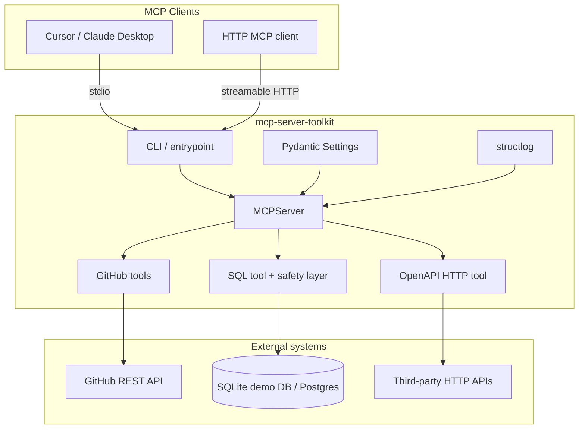

# MCP Server Toolkit

Production-style [Model Context Protocol](https://modelcontextprotocol.io/) server demo in Python. It showcases how to ship practical tools, safe SQL access, external HTTP integrations, structured logging, tests, and CI—the kind of integration work you'd put in a freelance portfolio.

## Features

- **Four tools**: GitHub repo/issue summaries (public API), read-only SQL (SQLite demo dataset + optional Postgres), OpenAPI-driven HTTP calls
- **Transports**: stdio (Claude Desktop / Cursor) and **streamable HTTP**
- **Config**: Pydantic Settings via `MCP_TOOLKIT_*` environment variables
- **Observability**: structlog JSON or console logs
- **Quality**: pytest suite, Ruff lint/format, GitHub Actions CI, Dockerfile

## Architecture



## Quickstart

### Requirements

- Python 3.11+
- Optional: `MCP_TOOLKIT_GITHUB_TOKEN` for higher GitHub rate limits (public repos work without it)

### Install

```bash
python -m venv .venv
source .venv/bin/activate
pip install -e ".[dev]"
```

Copy `.env.example` to `.env` and adjust values if needed.

### Run (stdio)

```bash
mcp-server-toolkit --transport stdio
```

### Run (streamable HTTP)

```bash
mcp-server-toolkit --transport streamable-http --host 127.0.0.1 --port 8000
```

MCP endpoint: `http://127.0.0.1:8000/mcp` (override with `MCP_TOOLKIT_HTTP_PATH`).

### Docker

```bash
docker build -t mcp-server-toolkit .
docker run --rm -p 8000:8000 mcp-server-toolkit
```

## Client configuration

### Cursor / Claude Desktop (stdio)

```json
{
  "mcpServers": {
    "mcp-server-toolkit": {
      "command": "mcp-server-toolkit",
      "args": ["--transport", "stdio"],
      "env": {
        "MCP_TOOLKIT_LOG_LEVEL": "INFO"
      }
    }
  }
}
```

Use the full path to the virtualenv binary if `mcp-server-toolkit` is not on your `PATH`.

### Streamable HTTP (example)

Point your MCP client at `http://127.0.0.1:8000/mcp` when the server is running with `--transport streamable-http`.

## Tools

| Tool | Description |
|------|-------------|
| `summarize_github_repository` | Fetches repo metadata and lists recent open issues (`owner`, `repo`). |
| `summarize_github_issue` | Summarizes one issue (`owner`, `repo`, `issue_number`). |
| `run_readonly_sql` | Runs a validated `SELECT`/`WITH` query. Optional `database_url` override. Demo DB is seeded from `demo_data/seed.sql`. |
| `call_openapi_operation` | Loads an OpenAPI 3 spec (`spec_url` or `spec_text`) and calls an operation by `operationId`. Supports `path_params`, `query_params`, and `json_body`. |

### SQL safety

- Single statement only
- Must start with `SELECT` or `WITH`
- Blocks write/DDL/admin keywords (`INSERT`, `DROP`, `PRAGMA`, …)
- Appends `LIMIT` when missing (default `MCP_TOOLKIT_MAX_SQL_ROWS=100`)

### Example prompts

- "Summarize the GitHub repo `modelcontextprotocol/python-sdk`."
- "Run read-only SQL: total order quantity by product name from the demo database."
- "Using the demo OpenAPI fixture, call operation `httpbinGet` with greeting hello."

## Development

```bash
ruff check .
ruff format .
pytest -q
python -m mcp_server_toolkit --transport stdio
```

Postgres support is optional: `pip install mcp-server-toolkit[postgres]` and set `MCP_TOOLKIT_DATABASE_URL` to a `postgresql://` URL.

## License

MIT — see [LICENSE](LICENSE).
