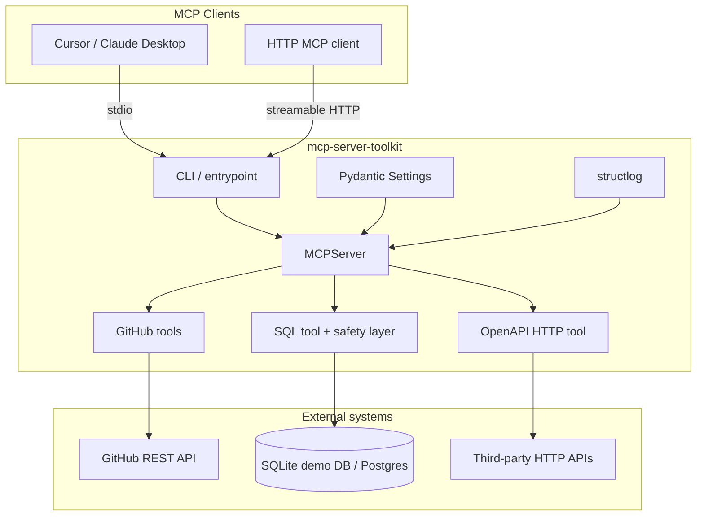

# MCP Server Toolkit

Production-style [Model Context Protocol](https://modelcontextprotocol.io/) server demo in Python. It showcases how to ship practical tools, safe SQL access, external HTTP integrations, structured logging, tests, and CI—the kind of integration work you'd put in a freelance portfolio.

## Features

- **Four tools**: GitHub repo/issue summaries (public API), read-only SQL (SQLite demo dataset + optional Postgres), OpenAPI-driven HTTP calls
- **Transports**: stdio (Claude Desktop / Cursor) and **streamable HTTP**
- **Config**: Pydantic Settings via `MCP_TOOLKIT_*` environment variables
- **Observability**: structlog JSON or console logs
- **Quality**: pytest suite, Ruff lint/format, GitHub Actions CI, Dockerfile

## Architecture



## Quickstart

### Requirements

- Python 3.11+
- Optional: `MCP_TOOLKIT_GITHUB_TOKEN` for higher GitHub rate limits (public repos work without it)
- Required for networked OpenAPI calls: `MCP_TOOLKIT_OPENAPI_ALLOWED_HOSTS`

### Install

```bash
python -m venv .venv
source .venv/bin/activate
pip install -e ".[dev]"
```

Copy `.env.example` to `.env` and adjust values if needed.

### Run (stdio)

```bash
mcp-server-toolkit --transport stdio
```

### Run (streamable HTTP)

```bash
mcp-server-toolkit --transport streamable-http --host 127.0.0.1 --port 8000
```

MCP endpoint: `http://127.0.0.1:8000/mcp` (override with `MCP_TOOLKIT_HTTP_PATH`).

### Docker

```bash
docker build -t mcp-server-toolkit .
docker run --rm -p 8000:8000 -v mcp-data:/data mcp-server-toolkit
```

The demo SQLite database is seeded once at startup into `MCP_TOOLKIT_DATA_DIR` (default `/data` in the container).

## Client configuration

### Cursor / Claude Desktop (stdio)

```json
{
  "mcpServers": {
    "mcp-server-toolkit": {
      "command": "mcp-server-toolkit",
      "args": ["--transport", "stdio"],
      "env": {
        "MCP_TOOLKIT_LOG_LEVEL": "INFO",
        "MCP_TOOLKIT_OPENAPI_ALLOWED_HOSTS": "httpbin.org"
      }
    }
  }
}
```

Use the full path to the virtualenv binary if `mcp-server-toolkit` is not on your `PATH`.

### Streamable HTTP (example)

Point your MCP client at `http://127.0.0.1:8000/mcp` when the server is running with `--transport streamable-http`.

## Tools

| Tool | Description |
|------|-------------|
| `summarize_github_repository` | Fetches repo metadata and lists recent open issues (`owner`, `repo`). Slugs must match `[A-Za-z0-9._-]`. |
| `summarize_github_issue` | Summarizes one issue (`owner`, `repo`, `issue_number`). |
| `run_readonly_sql` | Runs a validated `SELECT`/`WITH` against the **configured** database only (no per-call URL override). |
| `call_openapi_operation` | Loads an OpenAPI 3 spec (`spec_url` or `spec_text`) and calls an operation by `operationId`. Outbound HTTP requires an allowlist. |

### Database configuration

- **SQLite (default):** `MCP_TOOLKIT_DATABASE_URL=sqlite:///demo.db` seeds a demo database from packaged `seed.sql` into `MCP_TOOLKIT_DATA_DIR` on first startup. Queries open the file in SQLite **read-only** mode.
- **Postgres (optional):** install `mcp-server-toolkit[postgres]` and set `MCP_TOOLKIT_DATABASE_URL=postgresql://…`. Queries run in a **READ ONLY** transaction with `statement_timeout`.
- The SQL tool never accepts a caller-supplied connection string; change `MCP_TOOLKIT_DATABASE_URL` and restart the server instead.

### SQL safety

- Single statement only
- Must start with `SELECT` or `WITH`
- Blocks write/DDL/admin keywords (`INSERT`, `DROP`, `PRAGMA`, …)
- Enforces row caps with `SELECT * FROM (<query>) AS _mcp_toolkit_limited LIMIT n` so trailing comments or nested `LIMIT` clauses cannot bypass the cap (`MCP_TOOLKIT_MAX_SQL_ROWS`, default 100)

### OpenAPI outbound HTTP safety

- `MCP_TOOLKIT_OPENAPI_ALLOWED_HOSTS` (comma-separated) must include every host used by the spec URL and the operation URL
- Empty allowlist blocks all outbound OpenAPI HTTP until configured
- `http`/`https` only; redirects disabled; resolved IPs must not be private, loopback, or link-local
- Response bodies capped by `MCP_TOOLKIT_OPENAPI_MAX_RESPONSE_BYTES`; `Set-Cookie` headers are stripped from tool output
- **DNS rebinding:** hostnames are resolved and checked immediately before each request. This does not eliminate every time-of-check/time-of-use race against a malicious DNS resolver that changes answers between validation and connect; treat the allowlist as a guardrail for demo use, not a complete SSRF boundary on its own.

### Self-contained `httpbinGet` example

Set `MCP_TOOLKIT_OPENAPI_ALLOWED_HOSTS=httpbin.org`, then call `call_openapi_operation` with:

```json
{
  "operation_id": "httpbinGet",
  "spec_text": "{\"openapi\":\"3.0.3\",\"info\":{\"title\":\"Demo\",\"version\":\"1.0.0\"},\"servers\":[{\"url\":\"https://httpbin.org\"}],\"paths\":{\"/get\":{\"get\":{\"operationId\":\"httpbinGet\",\"responses\":{\"200\":{\"description\":\"OK\"}}}}}}",
  "query_params": {"greeting": "hello"}
}
```

### Example prompts

- "Summarize the GitHub repo `modelcontextprotocol/python-sdk`."
- "Run read-only SQL: total order quantity by product name from the demo database."
- "Call OpenAPI operation `httpbinGet` against httpbin with `greeting=hello`."

## Development

```bash
ruff check .
ruff format .
pytest -q
python -m mcp_server_toolkit --transport stdio
```

Postgres support is optional: `pip install mcp-server-toolkit[postgres]` and set `MCP_TOOLKIT_DATABASE_URL` to a `postgresql://` URL.

## License

MIT — see [LICENSE](LICENSE).
